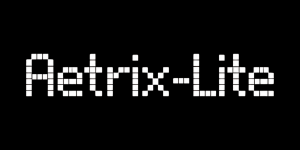

# Aetrix-Lite



## Contents

* [Overview](#overview)
* [Features](#features)
* [Game Modes](#game-modes)
* [How It Works](#how-it-works)
* [How to Play](#how-to-play)
* [Installation](#installation)
* [Future Development](#future-development)

## Overview

**Aetrix-Lite** is a modern falling block puzzle game developed in Python using Pygame. The project is based around the classic falling block puzzle formula, while introducing its own interface, piece designs, game modes, and supporting systems.

The main objective is to place falling pieces onto the board, complete horizontal lines, and continue playing for as long as possible or until the selected game mode has been completed.

Aetrix-Lite is the first build of what is planned to become a much larger project. This version focuses on establishing the core gameplay and systems required for a complete singleplayer experience without attempting to include every feature planned for the future.

Several elements of the game, including the HUD layout, settings menu, and rotation system (specifically the 180 degree kick table), take inspiration from **TETR.IO**. The future full version of the project will be developed separately as **Aetrix**.

## Features

* **Falling Block Gameplay**  
  Place and rotate falling pieces to complete lines and clear the board.

* **Multiple Game Modes**  
  Includes Zen, Blitz, and 40 Lines, each providing a different way to play.

* **Seven Bag Randomisation**  
  Uses a 7 bag system to distribute pieces in a more consistent and predictable way.

* **Hold and Next Queue**  
  Store a piece for later use and preview upcoming pieces before they spawn.

* **Ghost Piece**  
  Shows where the current piece will land, making piece placement easier to judge.

* **Piece Rotation System**  
  Aetrix-Lite uses a rotation system based off TETR.IO's SRS+. Pieces can be rotated with wall kick behaviour, including a TETR.IO inspired 180 degree kick table to allow more flexible placements around the board.

* **HUD & Configurable Controls**  
  Features an intuitive HUD and configurable settings menu inspired by TETR.IO, with keybinds stored externally.

* **Persistent Settings**  
  Settings and controls are stored using a JSON configuration file.

* **Pause and Restart**  
  Games can be paused, restarted, or exited back to the main menu.

* **Keyboard and Mouse Support**  
  Both keyboard input and mouse interaction are supported throughout the interface.

## Game Modes

### Zen

Zen is the standard endless mode. There is no time limit or line target, allowing the player to continue playing until they top out.

### Blitz

Blitz is a timed mode where the player attempts to achieve the highest score possible before the timer expires.

### 40 Lines

40 Lines challenges the player to clear 40 lines as quickly as possible. The final time is used to measure the player's performance.

## How It Works

Aetrix-Lite uses a grid based board to manage piece placement and line clearing. Pieces are created and controlled independently from the board, allowing the different parts of the game to interact without being tightly coupled.

When a piece spawns, the player can move and rotate it while it falls. Collision detection prevents pieces from moving through occupied cells or outside the playable area. Once a piece can no longer move down, it is placed onto the board.

After placement, the game checks for completed lines. Any completed rows are removed and the remaining cells are shifted down. The player's score and other game statistics are then updated before the next piece is spawned.

The game also maintains a queue of upcoming pieces and a held piece, allowing players to plan placements several pieces ahead.

## How to Play

1. Launch **Aetrix-Lite**.
2. Select **Play** from the main menu.
3. Choose a game mode.
4. Control the falling piece using the configured controls.
5. Move and rotate the piece into position.
6. Use the ghost piece to judge where the piece will land.
7. Place pieces to complete horizontal lines.
8. Use **Hold** and the **Next Queue** to plan future placements.
9. Continue playing until the selected game mode is completed or the board is topped out.

The default controls can be viewed and changed through the **Settings** menu.

## Installation

To run Aetrix-Lite, you'll need Python installed on your system. Follow these steps to get started:

### Windows

1. Download the latest release of Aetrix-Lite
2. Unpack `aetrix-lite-1.0.0.zip` and go into `aetrix-lite`
3. Install the Python dependencies with `pip install -r requirements.txt` or `install.bat`
4. Run the main program by running `python main.py` or `run.bat`

### macOS / Linux

1. Clone this repository:
   ```shell
   git clone https://github.com/voltage-86/aetrix-lite.git
   ```
2. Open the root directory of the project
   ```shell
   cd aetrix-lite
   ```
3. Install the Python dependencies with:
   ```shell
   pip install -r requirements.txt
   ```
   <details>
   <summary>Virtual Environment</summary>

   It is recommended to use a [virtual environment](https://docs.python.org/3/library/venv.html) for installing the required packages. To do this, run:
   ```shell
   python3 -m pip install venv
   python3 -m venv venv
   source venv/bin/activate
   ```
   If you use a virtual enviroment, you'll have to run `source venv/bin/activate` every time you want to run the program, but you won't risk breaking any system required libraries or dependencies for other programs. After activating the virtual enviroment, you ran install the required dependencies with `pip install -r requirements.txt`
   </details>
4. Run the main program `main.py`:
   ```shell
   python main.py
   ```

## Future Development

Aetrix-Lite is intended to serve as the foundation for the larger Aetrix project.
The next version is planned as a complete rewrite in Rust, allowing the project to be expanded beyond the scope of the original Python implementation.

Planned features for Aetrix include:

* Multiplayer
* Player skins and customisation
* Music and sound effects
* Additional game modes
* Expanded statistics and progression
* Online features
* Leaderboards
* Improved visual effects and presentation
* More advanced gameplay systems

Aetrix-Lite is therefore not intended to be the final version of the project. It provides the foundation for experimenting with the gameplay and systems that will eventually be developed further in Aetrix.
